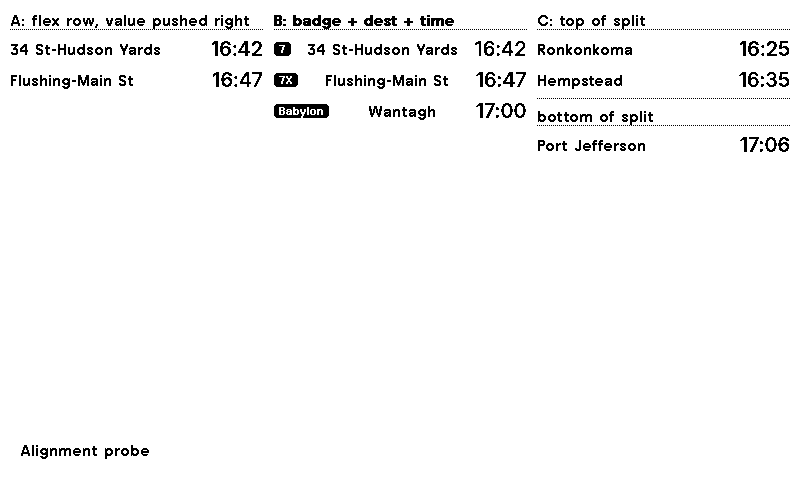
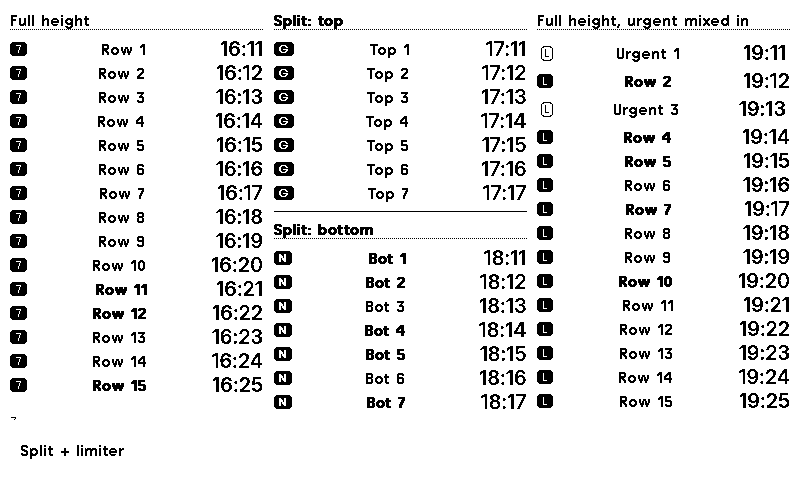

# Phase 2 — the layout, on TRMNL's framework

Phase 1 proved the data path and renders debug text. This is the plan for the
board itself, built on the TRMNL design framework rather than the hand-written
CSS the spec originally assumed.

Everything below was verified by rendering it: each claim about what the
framework does comes from a PNG built with `trmnlp build --png`, not from
reading the docs.

---

## 1. The answer to the configurability question

**Yes — three columns, each independently splittable into two.**

`grid--cols-3` gives an explicit three-column structure, and a `.col` holds
stacked blocks separated by a `border--h-*` rule. Rendered and confirmed: a
column carrying two headed blocks with a divider sits beside two unsplit
columns without disturbing them.

So the slot model from the spec survives, and the form does not change:

```
Card 1 │ Card 3 │ Card 5      ← top of each column
───────┼────────┼───────      ← divider, only where that column is split
Card 2 │ Card 4 │ Card 6      ← bottom
```

A column with one active card gets the full height; a split column divides it.
That is the same `cardsInColumn` behaviour the dashboard already has, and the
backend already emits slot numbers, so nothing upstream changes.

### Why not `Columns`

The framework's `Columns` component distributes items automatically and
manages overflow, which sounds like a better fit than it is. It is built for
*one* stream of same-type data flowing into however many columns fit. This
board is **positional**: specific stations in specific places, chosen by the
user. Two cards' rows must never flow into each other.

`Grid` is the right primitive — the docs are explicit that it is for "fixed
column structure and spans," while `Columns` is for automatic distribution.

---

## 2. What each piece of the old design maps to

The brief was to get close, not identical, and to prefer framework components.
Rendered comparisons behind each row:

| Dashboard | Framework | Notes |
|---|---|---|
| `DepartureRow` (custom flex) | `flex flex--row flex--between` | A bare flex row beat the `Item` component here — see below. |
| Route bullet / rect badge | `label label--small label--filled` | Renders as a filled chip. Carries `7`, `7X`, `Babylon` legibly. |
| Destination, clipped | `title title--small` + `data-clamp="1"` | Framework clamps with ellipsis rather than hard-clipping. |
| Departure time | `value value--xsmall` | Right-aligns naturally at the end of a `flex--between` row. |
| Urgent row (inverted) | `item--emphasis-2` / `-3` | **Open question** — see §4. |
| Card header | `label label--underline` | A captioned rule; lighter than the old 34px header block. |
| Dotted rule under header | included in `label--underline` | One component instead of two. |
| Direction subheading | `label label--small` | |
| Card boundary | `border--h-40` | On 1-bit this dithers to read as gray. |
| "Last updated" footer | `title_bar` | Framework's own, 40px, sits as a sibling of `layout`. |

### `Item` was tried and rejected

`Item` is the framework's row component and looked like the obvious match for
`DepartureRow`. Rendering it showed two problems:

- **`.meta` is an emphasis bar, not a badge slot.** It renders as a solid
  black vertical bar — that is its job, and it darkens further with
  `item--emphasis-3`. It cannot hold a route badge.
- **`.value` does not right-align inside `.content`.** It sits inline after
  the title, so times do not form a column.

A plain `flex flex--row flex--between` row gives badge, destination and
right-aligned time directly, and is what the rendered probe shows working.
`Item` stays available if a card ever needs the emphasis bar.

---

## 3. The layout

```
┌─────────────────────────────────────────────────────────┐
│ view                                                    │
│ ┌─────────────────────────────────────────────────────┐ │
│ │ layout                                              │ │
│ │ ┌─────────────┬─────────────┬─────────────┐         │ │
│ │ │ grid--cols-3                            │         │ │
│ │ │ col         │ col         │ col         │         │ │
│ │ │ ┌─────────┐ │ ┌─────────┐ │ ┌─────────┐ │         │ │
│ │ │ │ label   │ │ │ label   │ │ │ label   │ │ ← card  │ │
│ │ │ │ row     │ │ │ row     │ │ │ row     │ │   header│ │
│ │ │ │ row     │ │ │ row     │ │ │ row     │ │         │ │
│ │ │ ├─ border ┤ │ │ row     │ │ │ row     │ │ ← split │ │
│ │ │ │ label   │ │ │ row     │ │ │ row     │ │   only  │ │
│ │ │ │ row     │ │ │ row     │ │ │ row     │ │   where │ │
│ │ │ └─────────┘ │ └─────────┘ │ └─────────┘ │   needed│ │
│ │ └─────────────┴─────────────┴─────────────┘         │ │
│ └─────────────────────────────────────────────────────┘ │
│ title_bar                                               │
└─────────────────────────────────────────────────────────┘
```

A departure row:

```html
<div class="flex flex--row flex--between items--center gap--small">
  <span class="label label--small label--filled">7</span>
  <span class="title title--small flex--1" data-clamp="1">34 St-Hudson Yards</span>
  <span class="value value--xsmall">16:42</span>
</div>
```

The rendered probe (`images/phase2-layout-probe.png`) shows all three column
shapes working at once: a plain row with a right-aligned time, a row with a
route badge, and a column split into two headed blocks.



And the limiter spike, showing a split column dividing cleanly beside two
full-height ones, with outlined urgent rows in the third:



Three things that had to be found by rendering rather than reading:

- **`col--start`** — a `.col` centres its content vertically by default, which
  leaves a board floating in the middle of the panel.
- **`flex--1`** on the destination — without it the badge and time are pushed
  apart and the destination does not take the slack.
- **`w--full`** where a flex row sits inside `.content`.

---

## 4. Open questions, to settle by rendering

**1. ~~How does an urgent row read?~~ Settled for now: outlined.**

Four treatments rendered side by side — `label--outline` on the badge alone,
a `b--black bw--1` box around the whole row, full inversion
(`bg--black text--white`), and a trailing rule. All work on 1-bit.

**Taking the outlined row as a placeholder**, per instruction. It is clearly
distinguishable without the heaviness of inversion, which matters given the
standing concern that at a 10-minute threshold with typical walk times *most*
rows qualify — and a panel where most rows are solid black has no emphasis at
all. Worth revisiting alongside a threshold relative to `walkTime`.

**2. ~~How many rows fit?~~ Answered — the Content Limiter works.**

Fed 24 rows into each column and let the panel decide:

| Setup | Result |
|---|---|
| `data-content-limiter` with no height | ~15 rows, but leaves a clipped fragment |
| `data-content-limiter` + `data-content-max-height="170"` | **clean cut at 7 rows** |
| plain `overflow--hidden` | clips mid-row, unusable |

Two requirements the docs make easy to miss, both found by rendering:

- **The attribute must sit on an element with the `.content` class.** On a
  bare `div` it does nothing at all — the first spike looked like the feature
  was broken.
- **An explicit `data-content-max-height` is what makes the cut clean.**
  Without it the limiter still trims, but leaves a half-row fragment at the
  bottom.

**So `cardCapacity.ts` is not needed by the recipe.** The backend sends a
generous fixed number and the panel decides what fits — which also means the
row count stops depending on the backend knowing the layout. A split column
takes `max-height` at roughly half a full one; both render cleanly.

**3. Does "and X more" belong here?** The Content Limiter can append it.
Hiding a train behind a counter is arguably worse than showing fewer rows
cleanly. Lean toward off.

**4. Arrow-shaped railroad badges.** The dashboard clips badges into chevrons
to carry direction. `label` has no such variant. Options: drop them and rely
on the destination, use a semantic variant to distinguish city-bound, or keep
a small custom clip-path on top of the framework's label. Try in that order —
dropping is cheapest and may be enough now that the destination is always
shown.

**5. TRMNL X.** 1872x1404, and the store checklist requires testing both
landscape and portrait. The grid should adapt, but "should" is not "does".

---

## 5. Order of work

1. ~~**Content Limiter spike.**~~ Done — see Q2. The limiter works with
   `.content` plus an explicit max-height, so the backend can stop computing
   row counts.
2. **One card, rendered.** A single subway card with real data, compared
   against the dashboard's own render side by side.
3. **The grid.** Three columns, splits where the slot config says.
4. **Emphasis.** Settle Q1 by rendering the options.
5. **Badges.** Settle Q4.
6. **TRMNL X and the half/quadrant layouts.** The latter are currently
   placeholders that say so; the store checklist wants all four tested.

Steps 1-3 produce a board worth looking at. The rest is refinement.

---

## 6. What does not change

- The backend. It already emits slot numbers, card headings, column headings
  and rows; the Liquid consumes the same JSON.
- The form. The 3x2 slot model survives intact.
- The payload budget. 1,756 bytes measured, 34% of the cap — unless Q2 says
  the panel should receive more rows than it displays, which would raise it.
- The design rules: live data only, empty is not an error, per-card failures.
