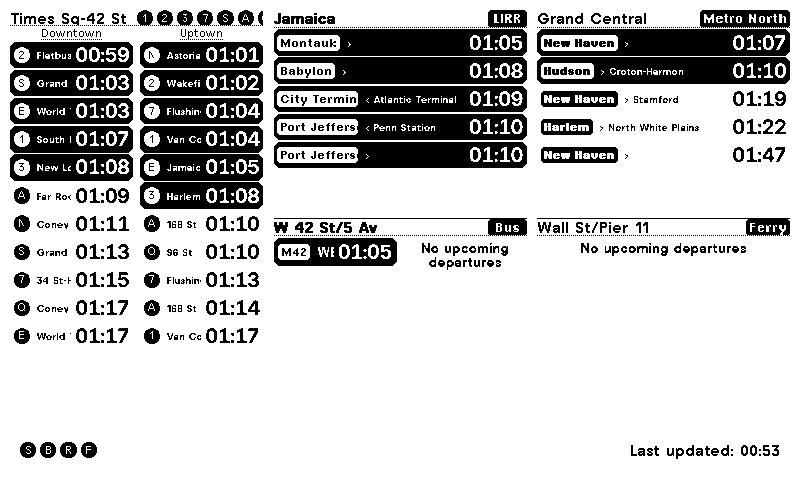

# NYC Transit Board

A [TRMNL](https://usetrmnl.com) recipe showing departures from the five
New York networks — subway, Long Island Rail Road, Metro-North, MTA bus
and NYC Ferry — filtered by how long it takes you to walk to the stop.

Every row on the panel is something you can still catch if you leave now.
That filter is the point: the MTA's own apps show you everything,
including the train pulling out as you read about it.

*Rendered just before 1am, which is why the bus and ferry cards are
quiet — "No upcoming departures" is a statement about now, not a
failure.*

## Documentation

**[User guide](USER-GUIDE)** — choosing stations, filtering routes,
picking a direction, splitting a station across two cards, and what to do
when a card looks wrong.

## What it does

- **Six cards** in three columns, each splittable in two
- **One search across all five networks**, with complexes and bus corners
  offered as single choices
- **Walk time filtering**, so unreachable departures are hidden
- **Route and direction filters** per card
- **Live data only** — no fallback to a printed timetable; if a feed says
  nothing is coming, the card says so rather than guessing
- **Per-card errors**, so a failing feed costs its own card and the rest
  of the board keeps working

## Source

[github.com/AlephFive/EInk-NYC-Home-Dashboard](https://github.com/AlephFive/EInk-NYC-Home-Dashboard)

Data comes from the MTA's realtime GTFS feeds, the MTA Bus Time SIRI API,
and NYC Ferry. This project is not affiliated with the MTA.
